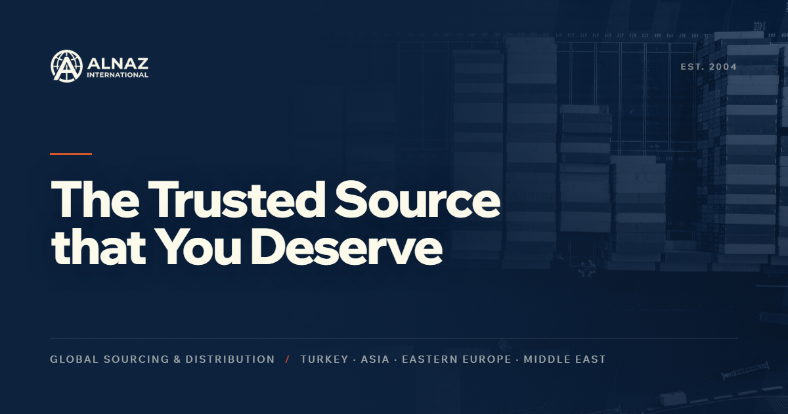

# ALNAZ International website

Marketing site for ALNAZ International, a trading company that sources and ships bulk commodities, construction materials, metals, vehicles, electronics and foodstuffs. It is a single-page homepage (hero, ticker, about, product desks, enquiry form) plus a products index and five statically generated category pages, built with [Next.js](https://nextjs.org) (App Router, bootstrapped with `create-next-app`), React, TypeScript, Tailwind CSS and Motion.

[](LICENSE)




## Getting started

Requires Node.js and npm.

```bash
npm install
npm run dev     # dev server on http://localhost:3000 (Turbopack)
npm run build   # production build
npm run start   # serve the production build
npm run lint    # ESLint (next lint was removed in Next.js 16)
```

There are no tests in this repo, and no environment variables are required.

The homepage lives in `src/app/page.tsx`; the page auto-updates as you edit it. Fonts are Wix Madefor Display and Wix Madefor Text, loaded through [`next/font`](https://nextjs.org/docs/app/building-your-application/optimizing/fonts).

## Structure

```
src/
  app/
    page.tsx                  homepage: SiteNav, Hero, Ticker, About, Products, Contact, SiteFooter
    layout.tsx                fonts and site-wide metadata (Open Graph, Twitter card, icons)
    actions.ts                submitEnquiry server action for the contact form
    products/
      page.tsx                products index
      [category]/page.tsx     one static page per category (generateStaticParams)
  components/                 section components and motion-primitives (Reveal, MaskedLines, Counter)
  lib/
    content.ts                nav, stats, certifications, markets, ticker and contact details
    catalog.ts                generated product catalogue: 5 categories, their groups and items
public/
  images/                     hero, section and catalogue photography
  logo.avif, icon.png, og.png brand assets
```

Editable copy lives in `src/lib/content.ts`. `src/lib/catalog.ts` is generated from the live category pages; regenerate it rather than hand-editing.

## Contact form

`submitEnquiry` validates the fields server-side (required name, valid email, minimum message length, length caps), drops honeypot submissions, and echoes values back so a validation error does not wipe the form. Enquiries are currently only logged server-side with `console.info`; wire an email provider or CRM webhook into `src/app/actions.ts` before relying on it.

## Learn more

- [Next.js documentation](https://nextjs.org/docs) - learn about Next.js features and API.
- [Learn Next.js](https://nextjs.org/learn) - an interactive Next.js tutorial.
- [Next.js deployment documentation](https://nextjs.org/docs/app/building-your-application/deploying)

## License

The code is released under the [MIT License](LICENSE). MIT covers the code; the ALNAZ name, logo and product photography identify the business and are not licensed under MIT.
